<table width="100%">
  <tr>
    <td align="center" bgcolor="#07111c">
      
    </td>
  </tr>
</table>

  
<strong>Explainable terrain-aware route planning for future Marswalks</strong>

  
NASA Space Apps Challenge 2026 · Interplanetary Survival Guide: Martian Map

  

    
    
    
  

## What is ARES PATH?

ARES PATH is an interactive geospatial workspace for exploring how Martian terrain changes a route-planning decision. It focuses on the Jezero Crater region and combines a checked local elevation model, aligned optical context, optional NASA Mars Trek layers and an explainable routing workflow.

The central idea is simple: instead of returning one opaque route, ARES PATH compares two explicit objectives over the same traversable terrain:

- **Shortest:** minimizes physical horizontal distance over valid cells.
- **Terrain-aware:** applies a declared slope-weighted exploratory cost.

The result is a reproducible comparison that a human planner can inspect, question and explain.

## The problem

A Mars map can show where a rover or explorer is located, but it does not automatically explain why one path is preferable to another. Regional and global layers are valuable for context, while a local planning workflow needs to preserve the raster geometry, metadata, resolution and limitations of the active dataset.

ARES PATH addresses that gap by connecting:

1. A real Mars elevation product.
2. A local raster map with an editable analysis window.
3. Deterministic terrain and traversability checks.
4. Two comparable route objectives.
5. Elevation, provenance and limitation views.
6. An offline Mission Pack for reviewing a saved result.

## What the project delivers

### Interactive map-to-route workflow

The user selects a validated Jezero dataset, moves or resizes an analysis area inside its bounds, chooses origin and destination grid cells, and requests a mission plan.

Before planning, the backend verifies:

- The region exists.
- The analysis window stays inside the active raster.
- Both points are inside the selected window.
- Elevation values are valid.
- The cells satisfy the configured slope constraint.
- A connected traversable component exists.

Invalid input produces a structured response with a code, human-readable message, reason, affected point and suggestion.

### Real terrain data

The numeric routing source is a processed HiRISE DTM from Mars Reconnaissance Orbiter. The associated HiRISE RED orthoimage is aligned to the same CRS, transform, shape and bounds and is used for display only.

The project also includes broad CTX Jezero regions derived from the USGS Mars 2020 CTX mosaics. NASA Mars Trek CTX and HiRISE layers are available as optional visual context and remain explicitly separate from the local routing source.

### Explainable route comparison

Each mission response exposes more than a line on a map:

- Route geometry.
- Physical distance.
- Ascent and descent.
- Sampled slope information.
- Expanded cells.
- Declared model cost.
- Elevation profile.
- Data sources and methodology.
- Limitations and error state.

The terrain-aware cost is an exploratory model quantity. It is not energy, time, probability of survival or a safety score.

### Offline Mission Packs

A Mission Pack stores a completed mission response, its elevation profile and a compact local preview in the browser.

It can be:

- Saved in IndexedDB.
- Exported as JSON.
- Imported into another browser.
- Reopened without the FastAPI process.
- Reviewed while disconnected.

Offline review does not calculate new routes, download new GeoTIFFs or guarantee access to live NASA WMTS layers. New route calculations require the backend.

## Why this approach is different

- It makes the route trade-off visible instead of hiding it behind a single recommendation.
- It treats the active local raster as the authoritative computational reference.
- It keeps remote orbital layers optional when alignment is not independently verified.
- It preserves the assumptions, source IDs and limitations alongside the result.
- It supports a reproducible local workflow and an honest offline review mode.
- It uses reusable UI components and typed contracts across the frontend and backend.

## Data inventory

| Dataset or resource | Use in ARES PATH | Resolution / role |
| --- | --- | --- |
| Mars Reconnaissance Orbiter / HiRISE DTM, <code>MRO-M-HIRISE-5-DTM-V1.0</code> | Elevation, slope, traversability and routing | Approximately 1 m/pixel local Jezero windows |
| HiRISE RED orthoimage, <code>PSP_002387_1985_RED_C_01_ORTHO</code> | Aligned optical context | Display only; shares the local DTM geometry |
| USGS Mars 2020 CTX DTM mosaic | Broad regional terrain coverage | 20 m/pixel; split into four Jezero quadrants |
| USGS Mars 2020 CTX orthoimage mosaic | Broad optical context | 5 m source resampled to the CTX DTM grid |
| NASA Mars Trek CTX and HiRISE services | Optional orbital visual context | Remote WMTS; online-only and alignment-aware |
| Local processed GeoTIFF sidecars | CRS, transform, bounds, checksums and provenance | Reproducibility and validation |

Full source records, URLs, hashes, processing notes and limitations are documented in [DATA_PROVENANCE.md](docs/science/DATA_PROVENANCE.md) and [nasa-data-sources.md](docs/nasa-data-sources.md).

## Technology

| Area | Technologies |
| --- | --- |
| Frontend | Next.js App Router, React, TypeScript, Tailwind CSS |
| Map and visualization | OpenLayers, Recharts, Lucide icons |
| Validation and testing | Zod, Vitest, Testing Library, Playwright, ESLint |
| Backend | FastAPI, Uvicorn, Pydantic |
| Geospatial processing | Rasterio, NumPy, GeoTIFF, Mars equirectangular rasters |
| Routing | Deterministic A* with traversability masks and terrain cost |
| Offline | Service Worker, Cache Storage and IndexedDB Mission Packs |
| Deployment | Vercel for the frontend, Render Docker Web Service for the backend |

## Run locally

### Prerequisites

- Node.js LTS.
- pnpm 10.
- Python 3.11 or newer, below 3.15.
- The processed GeoTIFF assets in <code>backend/data/processed</code>.
- Docker Desktop only for local container validation.

### 1. Start the backend

Open PowerShell from the repository root:

~~~powershell
Set-Location ./backend
python -m venv .venv
& ./.venv/Scripts/Activate.ps1
python -m pip install -e ".[dev]"
python -m uvicorn app.main:app --reload
~~~

The API will be available at:

- Swagger UI: [http://127.0.0.1:8000/docs](http://127.0.0.1:8000/docs)
- Health: [http://127.0.0.1:8000/api/health](http://127.0.0.1:8000/api/health)

### 2. Configure and start the frontend

Open a second terminal:

~~~powershell
Set-Location ./frontend
pnpm install --frozen-lockfile
Copy-Item .env.example .env.local
pnpm dev
~~~

Set the following value in <code>frontend/.env.local</code>:

~~~dotenv
NEXT_PUBLIC_API_URL=http://127.0.0.1:8000
~~~

Open [http://localhost:3000](http://localhost:3000).

When using Git Bash, run the equivalent shell commands. PowerShell commands such as <code>Get-ChildItem</code>, <code>Test-Path</code> and <code>./.venv/Scripts/...</code> are not Bash commands.

## Environment variables

### Frontend

~~~dotenv
NEXT_PUBLIC_API_URL=http://127.0.0.1:8000
~~~

For production, replace the local value with the public Render URL:

~~~dotenv
NEXT_PUBLIC_API_URL=https://your-ares-path-api.onrender.com
~~~

### Backend

~~~dotenv
ARES_DATA_ROOT=
ARES_CORS_ORIGINS=http://localhost:3000,http://127.0.0.1:3000
~~~

For Render:

~~~dotenv
ARES_DATA_ROOT=/app/data
ARES_CORS_ORIGINS=https://your-ares-path.vercel.app
~~~

Never commit <code>.env</code>, <code>.env.local</code>, credentials or private tokens.

## Verification

Run the backend checks from <code>backend/</code>:

~~~powershell
python -m pytest -q
~~~

Run the frontend checks from <code>frontend/</code>:

~~~powershell
pnpm lint
pnpm typecheck
pnpm test:run
pnpm build
pnpm test:e2e
~~~

The integration surface includes:

- <code>GET /api/health</code>
- <code>GET /api/system/info</code>
- <code>GET /api/data/regions</code>
- <code>GET /api/data/regions/{region_id}</code>
- <code>GET /api/data/regions/{region_id}/layers</code>
- <code>GET /api/data/mars-trek/layers</code>
- <code>POST /api/missions/plan</code>
- <code>POST /api/terrain/elevation-profile</code>
- <code>POST /api/routes/compare</code>

For the full API contract, see [docs/api-contract.md](docs/api-contract.md). For reproducible data validation, see [docs/validation.md](docs/validation.md).

## Deployment

The recommended prototype deployment is:

- **Frontend:** Vercel, with <code>frontend/</code> as the root directory.
- **Backend:** Render Docker Web Service, with <code>backend/</code> as the root directory.
- **Data:** processed GeoTIFFs and JSON sidecars included in the backend image.
- **PWA:** HTTPS on the public frontend domain.

Read the complete [Vercel + Render deployment guide](.context/DEPLOYMENT_VERCEL_RENDER.md) before publishing.

## Scientific boundaries

ARES PATH intentionally keeps its claims narrow:

- The local elevation GeoTIFF is the numeric source for slope, traversability and routing.
- The orthoimage and Mars Trek layers provide visual context only.
- NASA Mars Trek layers are optional and are not treated as aligned local elevation.
- <code>terrain_aware</code> is an exploratory slope-weighted cost, not energy, time or safety.
- The current scientific target entry is contextual and has no invented navigable coordinate.
- Offline mode reviews saved Mission Packs; it does not calculate new missions offline.
- The project is not operational EVA navigation or mission-certified guidance.

These boundaries are part of the product design. They protect the integrity of the NASA data and make the demo reproducible.

## Documentation

| Document | Purpose |
| --- | --- |
| [API contract](docs/api-contract.md) | Request and response shapes |
| [Data provenance](docs/science/DATA_PROVENANCE.md) | Sources, products, hashes and limitations |
| [Methodology](docs/methodology.md) | Terrain and route semantics |
| [Scientific layers](docs/science/SCIENTIFIC_LAYERS.md) | Layer roles and attribution |
| [Project status](docs/audit/PROJECT_STATUS.md) | Evidence-backed capability audit |
| [Judging readiness](docs/competition/JUDGING_READINESS.md) | Competition gaps and guardrails |
| [Demo plan](docs/competition/DEMO_PLAN.md) | Five-minute narrative and fallback plan |
| [Deployment guide](.context/DEPLOYMENT_VERCEL_RENDER.md) | Vercel, Render, PWA and production checks |
| [Frontend contracts](frontend/AGENTS.md) | Frontend implementation rules |
| [Team context](.context/AGENTS.md) | Shared project decisions and constraints |

## Responsible use

ARES PATH is built to make assumptions visible, not to replace scientific review or mission operations. Any future expansion should preserve:

- Data provenance and attribution.
- Deterministic, testable calculations.
- Explicit units and coordinate systems.
- Clear distinction between display context and numeric terrain input.
- Honest error states and limitations.
- Reviewable decisions by the project team.

## Credits and sources

ARES PATH is developed by **TukTuk Intergalactico** for the NASA Space Apps Challenge 2026.

Primary sources include:

- [NASA Mars Reconnaissance Orbiter / HiRISE DTM](https://www.uahirise.org/dtm/PSP_002387_1985)
- [NASA Mars Trek](https://trek.nasa.gov/mars/)
- [NASA Mars Trek Tile API](https://trek.nasa.gov/tiles/apidoc/trekAPI.html?body=mars)
- [USGS Mars 2020 CTX DTM Mosaic](https://www.usgs.gov/data/mars-2020-terrain-relative-navigation-ctx-dtm-mosaic)
- [USGS Mars 2020 CTX Orthoimage Mosaic](https://www.usgs.gov/data/mars-2020-terrain-relative-navigation-context-camera-orthorectified-image-mosaic)

Open-source libraries are listed in <code>frontend/package.json</code> and <code>backend/pyproject.toml</code>. Their individual licenses and notices remain applicable.
